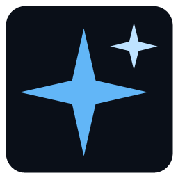
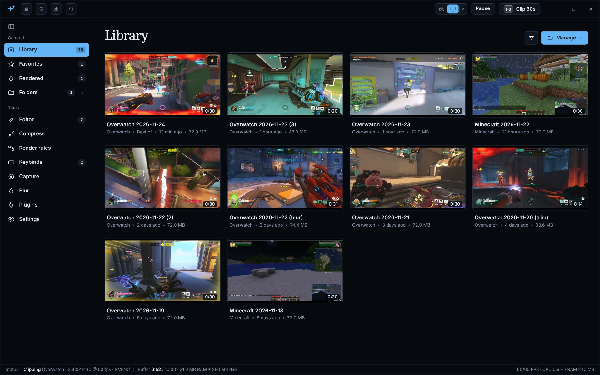
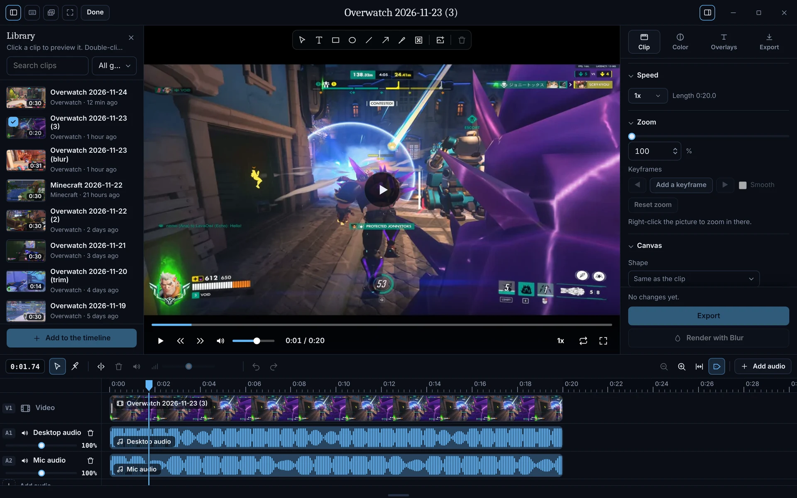
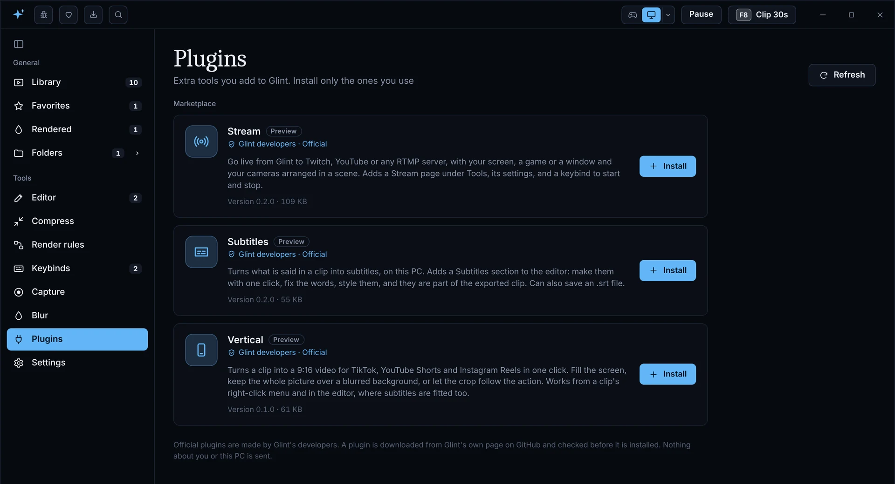
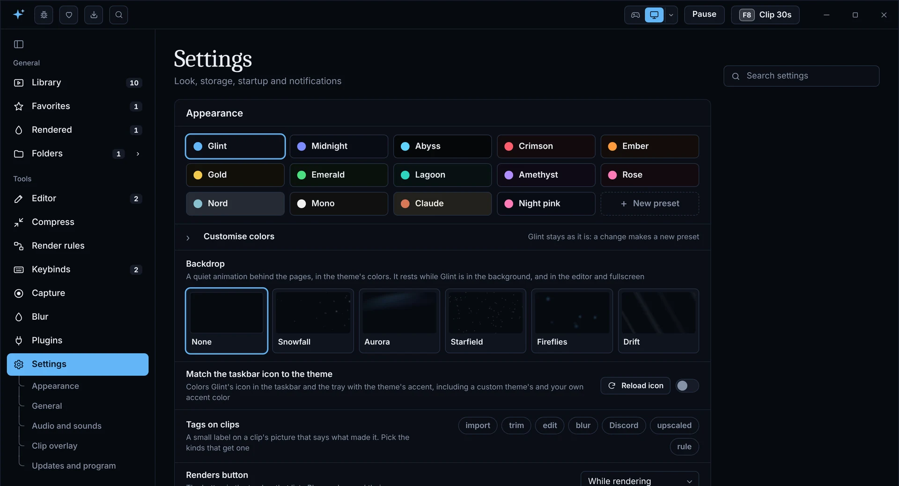
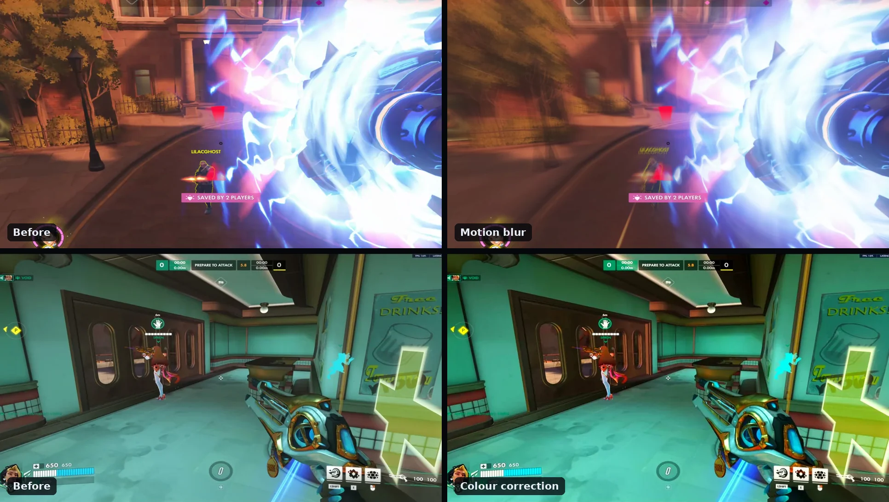

  

<h1 align="center">Glint</h1>

  <strong>Lightweight clipper with everything you need.</strong> 
  Press a key to record the last moments of your game or desktop.

  
  

  <a href="https://github.com/swamie/glint/releases/latest/download/GlintSetup.exe"><strong>Download</strong></a> ·
  <a href="https://glintclip.com">glintclip.com</a> ·
  <a href="docs/guide.md">Guide</a>

  

## Features

<table>
<tr>
<td width="40%" valign="middle">

### Inbuilt Editor

Cut, speed up, zoom, add text, blur and music on a real timeline. Game, voice chat and mic stay on separate tracks.

</td>
<td width="60%"></td>
</tr>
<tr>
<td width="40%" valign="middle">

### Build on what you need

Optional plugins for streaming, subtitles and vertical videos for TikTok, Shorts and Reels.

</td>
<td width="60%"></td>
</tr>
<tr>
<td width="40%" valign="middle">

### Personalisation

Pick a theme, change the colors, or write your own CSS.

</td>
<td width="60%"></td>
</tr>
</table>

**Native rendering.** Add interpolated motion blur and colour correction to your clips. It all renders on your own PC, with your graphics card doing the work.

  

**Light on your PC.** Glint uses about a third of the resources of apps like Medal, and about 1% CPU while it waits for your key.

It also has compress for Discord, GIF export, upscale for YouTube, and import from Medal, ShadowPlay, Outplayed and SteelSeries Moments.

## Install

1. Download [GlintSetup.exe](https://github.com/swamie/glint/releases/latest/download/GlintSetup.exe).
2. Run it. If Windows shows "Windows protected your PC", choose More info, then Run anyway. Windows flags it because Glint is [unsigned](https://learn.microsoft.com/windows/apps/package-and-deploy/smartscreen-reputation).
3. Press `F8` in a game.

Windows 10 and 11 only. Glint updates itself.

More in the [guide](docs/guide.md). Writing a plugin? See [plugins/README.md](plugins/README.md).

## Credits

Glint is built on other people's work: FFmpeg, Blur by f0e (tekno), Tauri, RNNoise, sherpa-onnx and more. The full list with licences is at [glintclip.com/credits](https://glintclip.com/credits.html), in the app under Settings, and in `THIRD_PARTY_LICENSES.txt` beside Glint.exe.

  <a href="https://glintclip.com">glintclip.com</a> · Found a bug? Use the bug button in the app.

